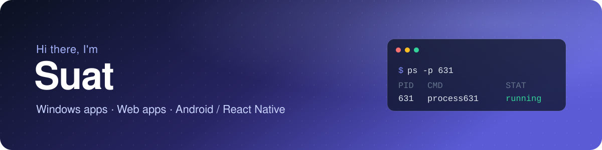

  
  
  

## About

I'm **Suat**, a developer building Android / React Native and Windows apps, along with practical web tools. I care about software that is fast, tested, and straightforward to use.

<!-- CONTACT: replace the line below with your real LinkedIn or email, then delete this comment. -->
**Contact / LinkedIn:** _add your LinkedIn or email here_

## Tech stack

Languages and tools I actually use in my public work, plus the mobile stack I'm building with:

  

- **Windows:** C#, .NET, WPF
- **Web:** TypeScript, React, Vite, Node.js
- **Mobile:** React Native, Android
- **Tooling:** Bash, GitHub Actions

## Featured projects

<table>
<tr>
<td width="50%" valign="top">

### 🧹 [DiskSweeper](https://github.com/process631/DiskSweeper)

A Windows 10/11 app that shows what's taking up space on your PC and lets you safely delete junk, leftovers, and installed programs or games. Includes a treemap, cleanup suggestions, an installer, and a `dsweep` command-line tool. Built with WPF and .NET 9, with automated tests and GitHub Actions releases.

**[Latest release (v1.1.0) →](https://github.com/process631/DiskSweeper/releases/latest)** &nbsp;·&nbsp; [Source](https://github.com/process631/DiskSweeper)

</td>
<td width="50%" valign="top">

### 🍴 [Forkcast](https://github.com/process631/forkcast)

Helps you decide what to cook, then walks you through it step by step. A few quick questions about meal, mood, time, and diet rank 790+ real recipes, each with the reasons it matches. Includes ingredient checklists, one-tap timers, and a full-screen cook mode that keeps your screen on.

**[Live site →](https://process631.github.io/forkcast/)** &nbsp;·&nbsp; [Source](https://github.com/process631/forkcast)

</td>
</tr>
</table>

Other public work

**[Web Recon Tools](https://github.com/process631/web-recon-tools)** — Bash scripts for passive and active reconnaissance on authorized lab targets only. They collect HTTP headers and bodies, snapshot security headers, optionally use httpx, and run conservative nmap scans of common web ports. No brute force, credential stuffing, or exploit modules.

 

<i>check your processes ;)</i>

