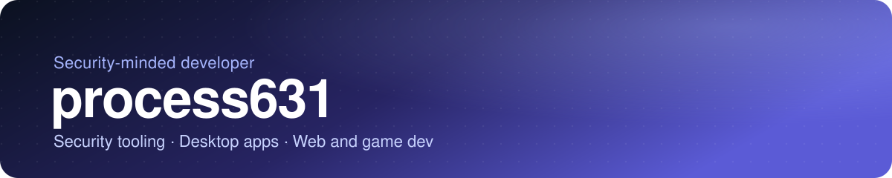

## About

Security-minded developer interested in security tooling, desktop apps, and web and game development.

## Tech stack

**Languages** — Python, TypeScript, JavaScript, C#, C++, Kotlin, Bash

**Platforms and frameworks** — .NET, WPF, Win32, React, Vite, Phaser, Node, Express, Discord.js

**Libraries and tools** — PostgreSQL, OpenCV, Playwright, Ghidra, YARA, Ollama

## Featured projects

- **[peanalyst](https://github.com/process631/peanalyst)** — Evidence-grounded static analysis of Windows PE files with a local LLM.
- **[DiskSweeper](https://github.com/process631/DiskSweeper)** — Windows disk-space analyzer and safe cleaner, C#/WPF.
- **[forkcast](https://github.com/process631/forkcast)** — React/TypeScript app to decide what to cook and follow recipes step by step.
- **[Vanguard Defense](https://github.com/process631/tower-defense)** — Phaser/TypeScript browser tower-defense campaign.
- **[Project Control](https://github.com/process631/dashboard)** — Local dashboard that inventories projects and scans for secrets before publishing.
- **[Battle Bot](https://github.com/process631/bott)** — Consent-based Discord duel bot.
- **[web-recon-tools](https://github.com/process631/web-recon-tools)** — Authorized-use Bash recon helpers.

